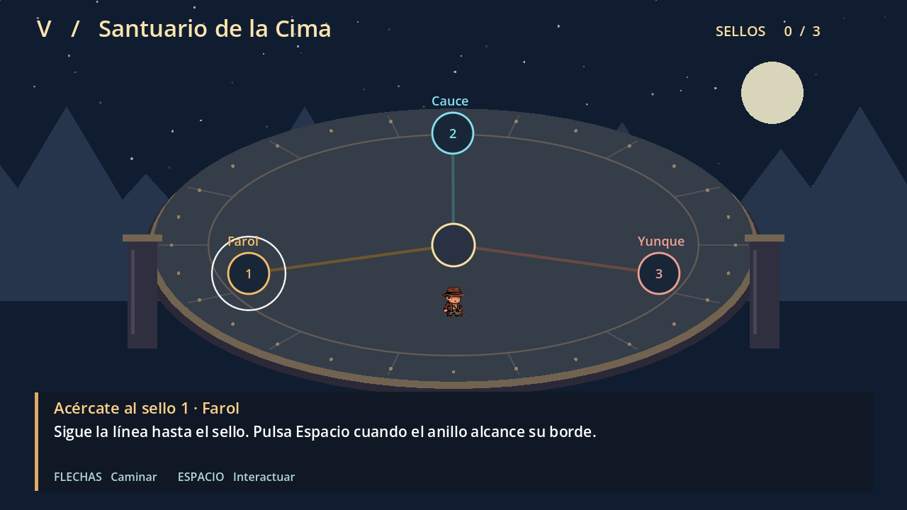

# Ecos del Orbe · Episodios I–V

Acompaña a Liceo desde el Vestíbulo hasta el Santuario. Al romper el orbe, Liceo descubre una torre atrapada en la misma mañana. Habla con la Farolera, el Guardián del cauce y el Herrero mientras reúne los tres fragmentos. En el Santuario las tres voces ayudan a reparar el orbe y abrir el portal de regreso.

## Jugar y editar

En el proyecto completo abre project.godot y pulsa F5. Para editar el comienzo abre scenes/quests/story_quests/forja_jenny/story escena intro.tscn.
Para integrar la versión GitHub copia scenes/quests/story_quests/forja_jenny a la misma ruta del proyecto Threadbare del equipo. Usa quest.tres como misión. La escena salida.tscn contiene el Santuario de la Cima y el desenlace. Para probar el último piso directamente, ábrela y pulsa F6.

1. El Vestíbulo Despierto. Sigue las indicaciones del orbe. En la galería usa las flechas y pulsa Espacio sobre las dos losas. Espera a que las tres puertas se abran.
2. Jardines. Elude guardias y espinas. Activa el farol para guardar tu posición y recoge el primer fragmento.
3. Acueductos. Desvía los proyectiles a núcleos del mismo color. Completa dos núcleos y evita los chorros para llegar al segundo fragmento.
4. Forja Ancestral. Escucha los pedestales y toca las dos melodías con Espacio. Esquiva el fuego y reclama el último fragmento. Al recoger el tercer fragmento entras a la cripta de la víbora. También puedes practicar antes haciendo clic en LUNA. Recoge dos cristales y alcanza el portal antes de que la serpiente te atrape. Con los tres fragmentos, el portal lleva al Santuario. Una captura te devuelve al Vestíbulo.

5. Santuario de la Cima. Camina hacia el farol, el cauce y el yunque. Pulsa Espacio junto a cada sello cuando coincidan los anillos. Tras reunir las tres voces, regresa al centro para reparar el orbe y regresar a casa. El epílogo permite empezar de nuevo.

## Arte y prueba

Los archivos fuente de Aseprite y las animaciones importadas de Liceo están en episodios/arte. La víbora lunar usa los cuatro fotogramas de tus archivos de Aseprite. Las runas tienen notas y efectos animados propios.
La prueba automatizada en Godot recorrió los cinco pisos, verificó la vuelta a la entrada al tocar una puerta, la activación de las losas, los dos núcleos, las runas, la insignia, los tres fragmentos, los sellos, los sonidos, el final y el reinicio. Queda por probar con compañeros si el aviso de cada puerta da tiempo suficiente. Si cuesta distinguirlo, se alargará el aviso ámbar.

