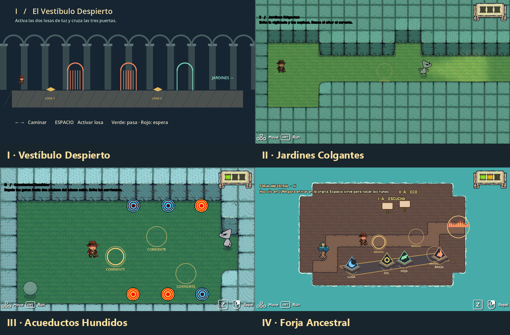

# Ecos del Orbe · Episodios I–IV

Acompaña a Liceo desde el Vestíbulo hasta la Forja. Despierta el orbe, esquiva las patrullas y reúne tres fragmentos para abrir el camino al Santuario.

## Jugar y editar

En el proyecto completo abre project.godot y pulsa F5. Para editar el comienzo abre scenes/quests/story_quests/forja_jenny/story escena intro.tscn.
Para integrar la versión GitHub copia scenes/quests/story_quests/forja_jenny a la misma ruta del proyecto Threadbare del equipo. Usa quest.tres como misión. La escena salida.tscn cierra estos cuatro episodios y se puede conectar al piso V.

1. El Vestíbulo Despierto. Sigue las indicaciones del orbe. En la galería usa las flechas y pulsa Espacio sobre las dos losas. Espera a que las tres puertas se abran.
2. Jardines. Elude guardias y espinas. Activa el farol para guardar tu posición y recoge el primer fragmento.
3. Acueductos. Desvía los proyectiles a núcleos del mismo color. Completa dos núcleos y evita los chorros para llegar al segundo fragmento.
4. Forja Ancestral. Escucha los pedestales y toca las dos melodías con Espacio. Esquiva el fuego y reclama el último fragmento. Haz clic en LUNA para entrar a la cripta opcional. Recoge dos cristales y alcanza el portal antes de que la serpiente te atrape. Una captura te devuelve al Vestíbulo.

## Arte y prueba

Los archivos fuente de Aseprite y las animaciones importadas de Liceo están en episodios/arte. Las runas tienen notas y efectos animados propios.
La prueba automatizada en Godot recorrió las cuatro escenas, verificó la vuelta a la entrada al tocar una puerta, la activación de las losas, los dos núcleos, las runas, la insignia, los tres fragmentos y el final. Queda por probar con compañeros si el aviso de cada puerta da tiempo suficiente. Si cuesta distinguirlo, se alargará el aviso ámbar.

