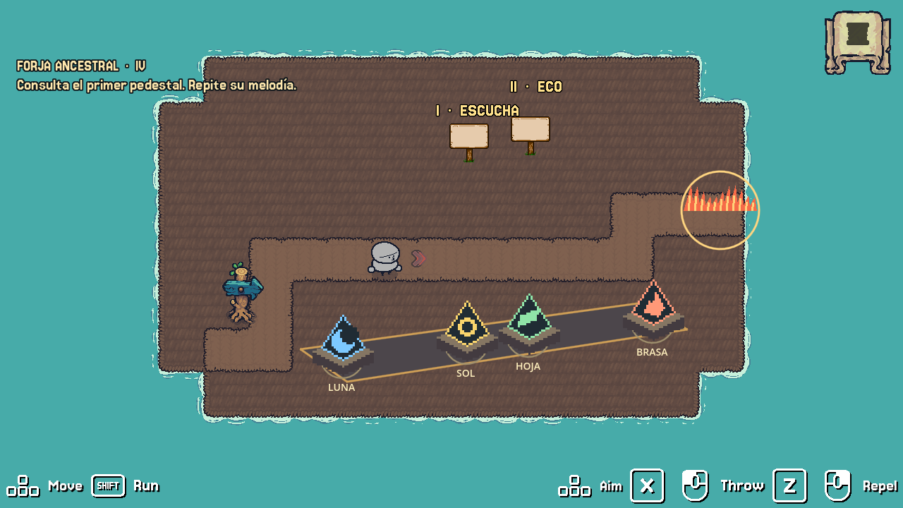

# Piso IV · La Forja Ancestral

Cuatro runas resuenan en el taller abandonado. Escucha los pedestales y golpea las runas en el orden que recuerdas. Si consigues apagar el fuego, Liceo recuperará el tercer fragmento del orbe. El herrero también dejó una firma secreta para quien quiera buscarla.

[Ver la prueba en movimiento](media/forja.gif) · [Incidencia del equipo](https://github.com/GameLab-7-0-UTP-Grupo8/StoryQuest/issues/9)

## Abrir en Godot

1. Usa el kit Threadbare que corresponde al proyecto del equipo. Copia la carpeta `scenes/quests/story_quests/forja_jenny` de esta rama a la misma ruta del kit. La rama distribuye la escena adicional y requiere el kit.
2. Espera a que Godot importe las notas y las imágenes. Abre `forja.tscn` y pulsa **F6**. También aparece en el libro de StoryQuests como **Ecos del Orbe · Piso 4**.
3. Muévete con las flechas. Acércate mirando hacia un pedestal o una runa y pulsa **Espacio**. Frente al fragmento, pulsa **Espacio** para hablar con la Voz Ancestral y terminar.

## Integración con el equipo

Entrada desde el piso 3: `res://scenes/quests/story_quests/forja_jenny/forja.tscn`. Al recoger el fragmento se abre `salida.tscn`, el cierre de esta entrega individual. Cuando esté listo el piso 5, selecciona `OnTheGround/CollectibleItem` y asigna la escena del Santuario en **Next Scene**. Para la aventura integrada, el equipo configura tres fragmentos en el recurso de la misión general. La misión individual de prueba concede uno.

## Qué se probó

| Prueba automatizada en Godot 4.7.1 | Resultado observado |
| --- | --- |
| Interactuar con las runas desde el área que detecta al jugador | La tecla Espacio activa la runa. Cada una usa una muestra WAV propia y una animación de golpe. |
| Introducir una nota repetida por error y continuar | El rompecabezas permite recuperar la secuencia. |
| Tocar BRASA, LUNA, BRASA | Aparece la insignia dorada del herrero. Esta secuencia secundaria no forma parte de las dos melodías necesarias. |
| Resolver los dos sellos | El AnimationPlayer reduce la intensidad del fuego mediante tres fotogramas clave. El coleccionable se revela. |
| Recoger el fragmento y avanzar el diálogo | Se alcanza la escena final del piso. |

**Observación y ajuste.** En la primera prueba era difícil distinguir los dos pedestales por su apariencia. Añadí los rótulos «I · Escucha» y «II · Eco», nombres a las runas y volví a probar el reto. La prueba anterior posicionó al personaje junto a cada elemento y envió Espacio por el sistema de entrada. Queda la prueba humana de orientación y movimiento libre con el equipo.

**Cambios frente a la plantilla.** La escena de secuencia tenía seis runas. Se retiraron la rosa y la morada, se conservaron las tres necesarias y se asignó la cuarta al reto opcional. El tiempo de demostración de cada nota pasó de 1 a 1,35 segundos en el Inspector. Las cuatro imágenes y las cuatro notas se crearon para esta Forja. La escena combina los pedestales de pista, el rompecabezas de secuencia y el coleccionable. El código de la insignia reconoce tres golpes consecutivos durante la partida.

Equipo de proyecto: Grupo 8. Rama del piso 4: `jenny46750`. Implementación, arte y audio preparados con asistencia de IA. La escena deriva de la plantilla de Threadbare bajo MPL-2.0. Ver [licencia](LICENCIA-MPL-2.0.txt).

## Plan de integración de los cinco pisos

Cada integrante desarrolla su piso en su propia rama. Los pisos 1 y 5 abren y cierran la historia. Los tres pisos intermedios entregan un fragmento cada uno. Los nombres de los responsables se completan cuando el equipo confirme el reparto.

| Piso | Escena y tarea | Hito de GitHub | Criterio para integrar |
| --- | --- | --- | --- |
| 1 | Vestíbulo Despierto. Liceo encuentra el orbe y despierta la torre. | Narrative Elements | El jugador desencadena el impacto y puede pasar al piso 2. |
| 2 | Jardines Colgantes. Situar patrullas, cobertura y un altar. | Characters & Creatures | El guardia detecta a Liceo si se expone. Llegar al altar permite recoger el fragmento 1. |
| 3 | Acueductos Hundidos. Distinguir los núcleos correctos de los señuelos y redirigir proyectiles. | Gameplay & Mechanics | Resolver el reto abre el puente y permite recoger el fragmento 2. |
| 4 | Forja Ancestral. Reproducir dos secuencias de runas utilizando pistas de luz y sonido. | Music & Sound | La secuencia correcta apaga las llamas y permite recoger el fragmento 3. |
| 5 | Santuario de la Cima. Reunir las tres piezas ante la Entidad Ancestral y regresar al presente. | Scene Setup & Layout | El juego comunica el desenlace y termina tras abrir el portal. |

Cada responsable registra la observación de una prueba, el cambio que decide realizar y el resultado al repetirla. La prueba del recorrido completo se hace después de integrar los cinco pisos.

[Tablero del Grupo 8](https://github.com/orgs/GameLab-7-0-UTP-Grupo8/projects/1/views/1)
